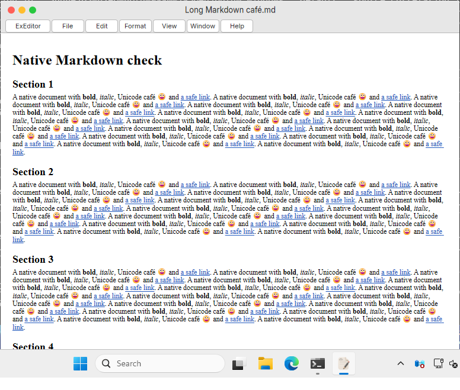

# ExEditor

ExEditor is a native Rust document editor whose interface and workflows follow macOS TextEdit. **Native Shell (nsh) draws the interface and supplies the native rich-text editor on Windows, macOS and Linux.** There is no browser editor or external LibreOffice dependency.

The `rust-nsh` migration replaces GPUI Kit/GPUI Fast and the live WordCraft editor. WordCraft file/print codecs remain at RTF/Office import/export and PDF boundaries; they do not own typing, selection, undo or the editor view. The first native migration build has passed GitHub validation; Windows runtime checks are recorded below. Its source includes native document input and IME, formatting, selection, undo/redo, tables, images, links, formatted clipboard operations, page setup, PDF export and system printing. Windows, macOS and Linux are GitHub build targets. Build validation and interactive acceptance are recorded in [CHANGELOG.md](CHANGELOG.md); source features are not a guarantee of complete TextEdit or Word compatibility.

*Native Windows build 18fd77d on a GitHub runner. This screenshot uses a generated test document.*

## Builds and testing

[Validated native build: 18fd77d](https://github.com/abelokoj/ExEditor/actions/runs/43636475163) includes three-platform packages, 161 Windows regressions, separate font/dictionary download checks, native Windows startup and same-window file opening, and installer registration checks. macOS/Linux runtime acceptance remains untested.

All compilation and diagnostics run on [GitHub Actions](https://github.com/abelokoj/ExEditor/actions). Do not compile or run source tests locally. Test execution is currently restricted to Windows; macOS and Linux build and package only. Finish feature source before starting a workflow. Pushes to `main`, `nsh-edit` and `rust-nsh`, pull requests and manual dispatches run the build workflow.

Download artifacts from a successful run. Windows includes an installer and a portable package; macOS includes an application bundle; Linux includes a portable archive. Build-record artifacts contain diagnostics, test logs and the resolved lockfile. The package's `build-info.json` identifies the source commit and architecture, and `SHA256SUMS.txt` records its contents. macOS bundles use an ad-hoc signature, not a Developer ID or notarization.

Release names follow ExcellentBible: `ExEditor-vYYYY-MM-DD.N-vSEMVER-platform`, using the America/New_York date, GitHub workflow-run counter and Cargo package version. All platforms share one identity per workflow. Windows installers end in `-win-x64.exe`, portable ZIPs in `-win-x64-port.zip`; About ExEditor and build records show the same release tag. Existing app installation paths and upgrade identity stay stable.

Keep downloaded GitHub builds in `dist/ExEditor-vYYYY-MM-DD.N-vSEMVER/`, with the installer, portable archive/extracted folder and build records together. Preserve older deliveries and never overwrite an existing numbered release. Windows packages must retain their bundled proofing runtime and licenses. Launch downloaded builds with an isolated `EXEDITOR_DATA_DIR` for interactive checks. Keep private development notes and source backups in ignored `dev_notes/`; never commit or push them.

For Linux, extract the archive and run `python3 install-desktop.py` in its folder to register that portable location in the current user's application menu. On macOS, place ExEditor.app in Applications and select it in Finder's Open With menu. On Windows, the installer offers Edit with ExEditor and Open With integration without taking over default associations.

## Editing

- Plain text and rich text with font family/size, bold, italic, underline, strikethrough, superscript/subscript, colors, paragraph alignment, spacing, indents, lists and tabs.
- Tables, links and embedded images; RTF/RTFD, HTML, DOCX and ODT documents. Legacy Word `.doc` imports are available; save an edited copy as DOCX or RTF.
- Find/replace, line editing and VS Code style desktop shortcuts. See [the complete shortcut reference](docs/KEYBOARD_SHORTCUTS.txt). Command is also accepted for Control-based application shortcuts on macOS.
- Automatic offline suggestions after three letters, using nearby document words and language keywords. Ctrl/Command+Space opens suggestions manually; arrows choose, Tab/Enter accepts, Escape dismisses. Disable automatic suggestions in Settings.
- Syntax coloring and light/dark code themes for recognized plain-text files. Screen colors do not rewrite saved document styles. Markdown has formatted reading and source modes.
- Rich clipboard copy/paste and explicit Paste Formatted HTML. Clipboard import never fetches remote media or reads linked local media. X11 rich copy provides HTML and text; other supported desktop clipboard adapters also publish RTF.
- Numbered untitled tabs with a configurable prefix, reopening files into existing tabs, and moving tabs between windows while retaining their editing sessions.
- Printer choice, copies, page ranges, duplex and grayscale settings, plus PDF export through the same document layout.

## Recovery and fonts

Unsaved documents retain automatic local snapshots. New snapshots include the complete native nsh rich-text model and page setup alongside backward-compatible plain text/RTF content; older ExEditor snapshots remain readable. Recovery preserves original snapshots when opening fails. Safe saves detect outside modifications and retain version history.

Inter Regular/Italic/Bold/Bold Italic is bundled for the interface. **Settings > Accessories** offers three optional downloads: Pretendard Std Regular/Bold with synthesized italics (about 0.9 MB), Maple Mono NF Regular/Italic/Bold/Bold Italic (about 9.6 MB), and Noto Color Emoji (about 10.7 MB). These font files remain in this GitHub repository and are excluded from the application executable and installer.

Downloads happen only when requested. Each file comes from a pinned repository commit, is size-bounded and SHA-256 verified, and is saved with its OFL license in ExEditor’s own accessories folder. Fonts become available immediately and remain available offline after restarting; no system font installation is performed. Missing or damaged accessories use the bundled/system fallbacks and can be downloaded again. Choose a downloaded family through Format > Font or New Document settings; installing it does not rewrite existing document formatting. Before those downloads, new installations use Inter for rich text and the platform monospace font for plain text; emoji use available system fonts.

Harper provides offline English grammar checking. **Language Tools** offers optional Hunspell dictionaries for English US/UK, French, German, Spanish and Portuguese Brazil/Portugal, Finnish Voikko, and ten Divvun language packs. Choose an engine, download a dictionary from this repository, choose **Use**, then **Apply**. Downloads show their sizes and include licenses and corresponding source archives; they are streamed, verified and kept outside the installer. No network access is needed after downloading, and manual dictionary import remains available. Selecting a non-English pack turns off English grammar checking. Language Tools supports these engines where their native runtime is available. Windows packages include the native proofing runtime. The Windows system dictionary remains a Windows-only provider; choose an offline provider on other platforms.

## Scope and compatibility

NSH runs as Rust on Win32/DirectWrite, AppKit/CoreText and GTK 4/Pango. No GPUI backend, browser editor or JavaScript VM is selected. macOS requires 14 or later; Linux requires GTK 4.14 or later and the GStreamer 1.0 runtime libraries. First-line/hanging indents, custom ruler tab stops and custom programmatic scrolling are not supported by NSH 0.5.0 and remain unavailable in this migration. No-wrap uses a content-width workaround capped at 64,000 pixels; unusually long lines can still wrap. Office import/export passes through HTML, so unsupported headers, footers, text boxes and advanced layout may simplify. The editor asks before replacing an imported original; Save As preserves that file. Native recovery retains the complete nsh schema and page setup. Broad real-world document fidelity, native IME, screen-reader use and physical printers still require platform acceptance testing.

## Attribution

Native Shell 0.5.0 is pinned to [f4d68f7f](https://github.com/longbridge/nsh/tree/f4d68f7f9f31eb7b3ecc8a4cbc31096d5c6238a1), with its license and rich-editor attribution under `assets/licenses/nsh/`. File/print codecs from WordCraft remain pinned to [729cd0a5](https://github.com/storytold/wordcraft/tree/729cd0a5fc953bbedbfdec4f6af18ad6d1780b3b). See [the adapter attribution](assets/licenses/wordcraft/NOTICE.txt) and the bundled font/proofing license files. ExEditor is distributed under [MIT](LICENSE).
